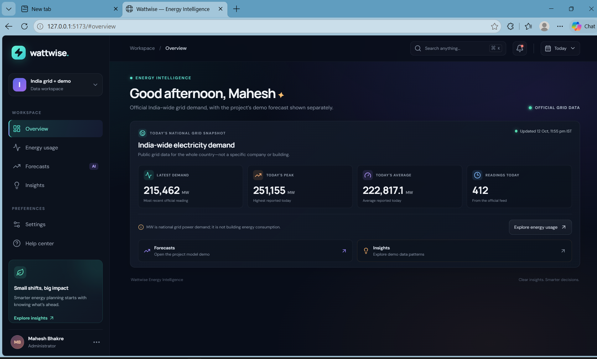
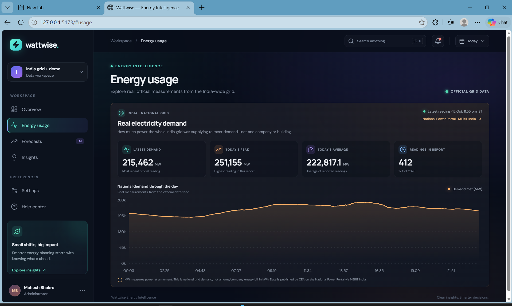
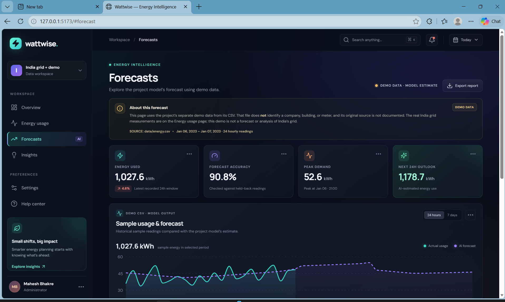
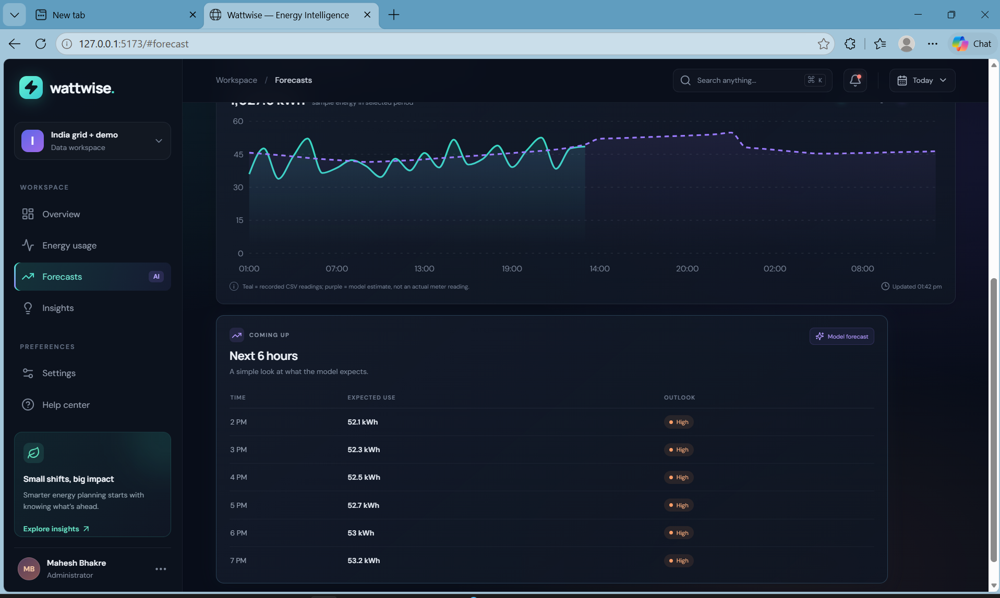
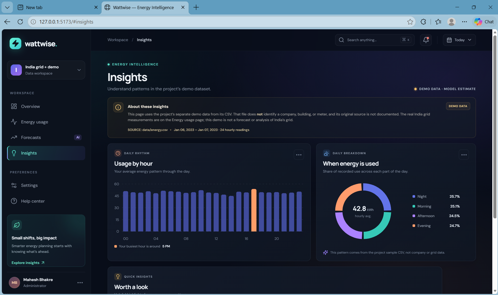

# AI Energy Forecasting System

A Python forecasting model and React dashboard for exploring hourly electricity demand, reviewing energy use patterns, and viewing short term estimates. The dashboard combines an India-wide grid demand feed with a separate local CSV and model demonstration.

## Project overview

The project has two related parts:

1. **India grid dashboard:** The Overview and Energy usage pages retrieve national electricity demand readings from the Central Electricity Authority (CEA) MERIT India data endpoint served by the National Power Portal. These readings are for the whole Indian grid and are reported in megawatts (MW).
2. **Forecasting demonstration:** The Forecasts and Insights pages use `data/energy.csv` and a saved scikit-learn model. This CSV is an unattributed demonstration dataset. It does not identify a real company, building, meter, or original data source. Its values and forecasts must not be interpreted as official grid readings or as measurements from a particular organization.

The dashboard refreshes its data periodically. National grid readings are cached by the local API for up to one minute. The browser interface refreshes every 30 seconds.

## Screenshots

Screenshots are stored in the [`images/`](./images/) folder and can be replaced or expanded as the project develops.

### Dashboard overview



### Energy usage



### Forecasts





### Insights



Additional charts and screenshots are available in [`images/`](./images/).

## Features

- Dashboard pages for Overview, Energy usage, Forecasts, and Insights.
- India-wide grid demand readings from the National Power Portal, including recent, peak, and average demand in MW.
- Hourly energy history and a 24-hour model estimate using the local demonstration dataset.
- Hourly profile, day-part distribution, summary metrics, and automatically generated observations.
- Python model training and evaluation using mean absolute error (MAE) and R-squared.
- Responsive React interface with charts and screenshot assets.

## Technology

- Python, pandas, NumPy, scikit-learn, and joblib
- React, Vite, Recharts, and Lucide React
- Python standard library HTTP server for the dashboard API

## Requirements

- Python 3.10 or newer
- Node.js 18 or newer and npm
- Internet access for the live India grid data panel

## Setup and run

Run these commands from the repository root. Use two terminals for the API and web dashboard.

### 1. Get the project

```bash
git clone https://github.com/maheshbhakre/AI-Energy-Forecasting-System.git
cd AI-Energy-Forecasting-System
```

### 2. Install Python dependencies

Create and activate a virtual environment, then install the requirements.

**Windows PowerShell:**

```powershell
py -m venv .venv
.\.venv\Scripts\Activate.ps1
python -m pip install -r requirements.txt
```

**macOS or Linux:**

```bash
python3 -m venv .venv
source .venv/bin/activate
python -m pip install -r requirements.txt
```

### 3. Start the local API

In the first terminal, run:

```bash
python server.py
```

The API listens at `http://127.0.0.1:8000`. It reads the demonstration CSV and the saved model under `models/`. If the model file is missing, train it with `python main.py` first.

### 4. Start the dashboard

In a second terminal, from the project folder, install the frontend packages and start Vite:

```bash
npm install
npm run dev
```

Open the local address printed by Vite, usually `http://127.0.0.1:5173`. The Vite development server forwards `/api` requests to the local Python API.

### Optional: train the forecasting model

With the Python virtual environment active, run:

```bash
python main.py
```

This trains an `MLPRegressor`, prints MAE and R-squared results, saves the model to `models/energy_model.pkl`, and displays an actual-versus-predicted plot. The script expects `Datetime` and `Energy` columns in `data/energy.csv`.

## Data and interpretation

The India grid panel uses measurements from the [National Power Portal MERIT India dashboard](https://npp.gov.in/dashBoard/gc-map-dashboard-meritchart). These are national electricity demand readings in MW, not building-level usage in kWh. The dashboard displays the source and unit with the grid data. Availability depends on the external portal.

The model demonstration uses `data/energy.csv`, whose columns include `Datetime` and `Energy`. The model derives hour of day and day of week features. Its estimates and evaluation are for demonstration only. The dataset does not document its origin, so the results should not be used for operational planning or attributed to a real facility. For organization-specific use, replace the CSV with authorized meter readings, document the site and source, and evaluate the model against a suitable time-based holdout.

## API endpoints

- `GET /api/health` returns a basic API health status.
- `GET /api/dashboard?period=24h` returns dashboard data for the 24-hour view.
- `GET /api/dashboard?period=7d` returns dashboard data for the 7-day view.

The API binds to `127.0.0.1:8000` for local use. The included Vite proxy is configured for local development.

## Repository layout

```text
AI-Energy-Forecasting-System/
|-- data/                 # Demonstration energy dataset
|-- images/               # Dashboard screenshots and charts
|-- models/               # Serialized forecasting models
|-- src/                  # React application and styles
|-- index.html            # Vite application entry point
|-- main.py               # Model training and evaluation
|-- server.py             # Local dashboard API
|-- package.json          # Frontend dependencies and commands
|-- requirements.txt      # Python dependencies
`-- vite.config.js        # Vite configuration and API proxy
```

## Security and configuration

The project does not require API keys or other credentials for its current local setup. Do not commit passwords, tokens, private keys, or local `.env` files. The repository ignore rules exclude environment files, virtual environments, dependency folders, build output, and Python caches.

## Maintainer

Mahesh Bhakre

## License

No license file is currently included. Unless a license is added, standard copyright restrictions apply and reuse permissions are not explicitly granted.
